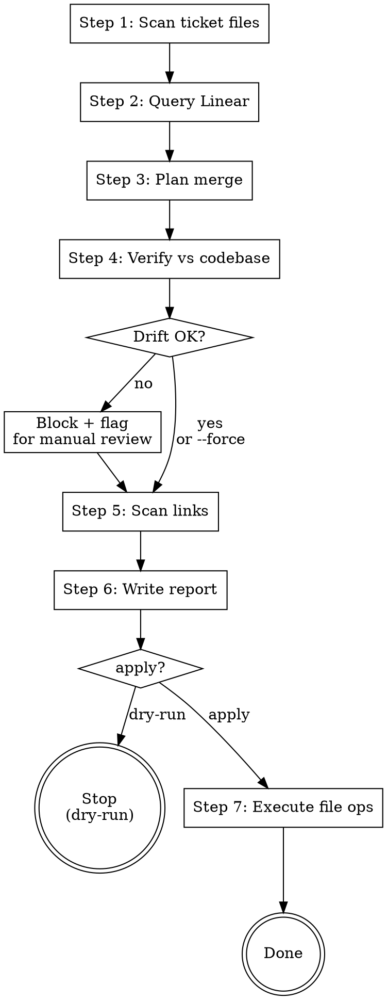

# Consolidate Docs

> 非 Claude Code（如 Pi）執行時，先讀 `../../references/harness-terms.md`（相對本檔；Claude Code 為 `${CLAUDE_PLUGIN_ROOT}/references/harness-terms.md`，照字面執行可略過），把 Claude 專屬工具與路徑換成對應項。

> 掃描 `{docs-root}`（依 `sdlc-docs-path`，未設定為 `docs/`）下所有帶 Linear 票號後綴的 CR 文件，若該票已 Done，先對 codebase / DB 事實驗證，再合併回主規格、改寫連結、刪除票號檔。

## When to Use

- 使用者輸入 `/sa-flow:consolidate-docs`
- 使用者明示「整理 docs」「合併票號文件」「整併變更單」
- 一個 CR 週期（FRD/SAD/BFS/FFS）票號收口、準備清理 `{docs-root}`
- **不主動觸發**：必須由使用者明示

## Parameters

| 形式 | 意圖 |
|---|---|
| `/sa-flow:consolidate-docs` | **預設 dry-run**：列出計畫但不寫檔 |
| `/sa-flow:consolidate-docs --apply` | 實際執行合併、刪除原檔、更新連結 |
| `/sa-flow:consolidate-docs <子目錄>` | 限定範圍，例：`/sa-flow:consolidate-docs 人事` |
| `/sa-flow:consolidate-docs --apply <子目錄>` | 子範圍實際執行 |
| `/sa-flow:consolidate-docs --skip-verify` | 跳過 Step 4 事實驗證（風險自負）|
| `/sa-flow:consolidate-docs --force-merge-with-drift` | 容忍 1-3 處輕微 drift 強制合併 |

## Core Principles

1. **預設 dry-run**：沒有 `--apply` 時絕不寫檔，只產報告
2. **只處理單票號**：含兩個以上票號（`xxx_ABC-1_ABC-2.md`）→ 列入「需人工裁決」
3. **只合併 Done 票**：非 Done、查無票 → 略過記入報告
4. **合併前必跑事實驗證**：票號檔提及的所有技術參照（路徑/類別/方法/SQL/欄位/API）必須對當前 codebase / DB 驗證，drift 阻擋自動合併（細節 → `references/verification-rules.md`）
5. **章節重整**：合併時票號檔的章節若是修改舊規則，主文件對應段落以新版取代；新增章節 append；保留主文件未被觸及的內容
6. **連結改寫**：全 docs 內所有指向已刪除票號檔的連結（含 `#anchor`）改寫指向主文件
7. **不自動 commit**：所有變更留 working tree，由使用者檢視 diff 後自行 commit

## Filename Parsing

- 正則：`^(?<base>.+)_(?<team>[A-Z]+)-(?<num>\d+)\.md$`
- 例：`請假單_功能調整後端規格書_ABC-395.md` → base=`請假單_功能調整後端規格書`, identifier=`ABC-395`
- 多票號（base 內含 `_[A-Z]+-\d+`）→ skip

### 主文件對應（依序嘗試）

1. **直接同名**：同目錄下 `<base>.md`
2. **CR 命名映射**：去除「_功能調整」「_異動」「_修改」等變更單關鍵字後比對
3. **Fuzzy match**：去除底線後與同目錄 `.md` 比對 base
   - 單一命中 → 自動採用，報告標「fuzzy 命中」
   - 多個命中 → 列入「需人工裁決」
   - 命中主檔為無底線舊風格時，先 `git mv` 改名為標準 `_` 形式
4. **皆失敗** → 新建 `<base>.md`

> **命名標準**：主文件採 `{module}_{doctype}.md`（底線分隔）。掃描時若發現無底線舊風格，合併過程自動 `git mv` 並同步改寫引用。

## Task Initialization (MANDATORY)

開始 workflow 前，用 TaskCreate 建立 7 個任務並嚴格 in_progress→completed 推進：

| Task | 主題 |
|---|---|
| 1 | Scan ticket-suffixed files |
| 2 | Query Linear statuses (batched) |
| 3 | Generate merge plan + resolve main-file mapping |
| 4 | Verify technical references vs codebase / DB |
| 5 | Scan cross-doc link references |
| 6 | Write report to `{docs-root}/.consolidate/report-{timestamp}.md` |
| 7 | (apply only) Execute file ops; (dry-run) stop after report |

每完成一個 task 前 verification 必須通過（見各步驟末「Verification」行）。

## Workflow

### Step 1: Scan

- Glob `{docs-root}/**/*_*-*.md`，過濾**末尾恰好一個票號**
- 子目錄參數若有 → 過濾範圍
- 排除 `{docs-root}/.consolidate/` 與 `{docs-root}/archive/`

**Verification**：取得 `{path, base, identifier, candidate-main-path}` 清單 + 數量；多票號檔已分離出「需人工裁決」桶。

### Step 2: Query Linear

對每個 identifier `mcp__linear__get_issue`：取 `state.name`、`title`、`description` 前 200 字、`url`。分類 Done / 其他 / 查無。

**Verification**：每張票分類完成；異常票（API 錯誤、查無）顯式記錄。

### Step 3: Generate Merge Plan

對每張 Done 票決議：
- 主文件存在 → 規劃「章節新增 / 取代 / 補充」
- 主文件不存在 → 票號檔內容當主文件草稿，移除「變更摘要」「修訂歷史」「Linear Ticket」等過渡性前言

**Verification**：每張 Done 票都有明確的主文件路徑與合併動作；無歧義映射。

### Step 4: Verify Against Codebase (MANDATORY)

從票號檔內文抽取技術參照清單，逐項對 codebase / DB 驗證。詳細抽取規則、驗證手段、drift 處置矩陣 → **`references/verification-rules.md`**。

簡要：
- **核心參照必驗**：CR 主敘事直接涉及的 entity / repository / handler / API / DB 物件 100%
- **次要參照抽樣**：附錄技術參照表 30%
- **Drift 處置**：1-3 處輕微 drift → 標需人工確認預設不合併；>3 處或 DB schema 不符 → 強制阻擋
- **`--skip-verify`**：跳過此步，報告標 ⚠️ **未驗證** 紅旗

**Verification**：每張 Done 票有「驗證項數 / 命中 / drift」三數字；阻擋的票已從合併佇列移出。

### Step 5: Scan Link References

Grep `{docs-root}/**/*.md` 找指向票號檔的連結（Markdown 連結與純路徑），記錄 `{引用檔, 行號, 原連結, 改寫後連結}`，保留 `#anchor`。

**Verification**：清單收斂；已知交叉引用（票號檔之間）標為「隨刪除自然消失」不需單獨處理。

### Step 6: Write Report

寫入 `{docs-root}/.consolidate/report-{YYYY-MM-DD-HHmm}.md`，含區塊：
- ✅ 已合併 / 計畫合併（依 mode）
- ⏭️ 略過 - 非 Done
- ❓ 異常 / 多票號 / 需人工裁決
- 🔬 事實驗證（每張票驗證項數、drift 清單）
- 🔗 連結更新清單
- 📁 命名標準化（若有 git mv）
- 🧹 規格鏈中間產物清理（Step 7 第 5 點的候選／已刪清單）

`{docs-root}/.consolidate/` **必須在 `{docs-root}/.gitignore` 中排除**；首次執行若未含則主動補上。

**Verification**：報告檔已寫入且包含全部 7 區塊；摘要行可貼回 chat。

### Step 7: Apply (only if `--apply`)

對每個 Done 項：
1. Write 合併後內容至主文件
2. `git rm` 票號檔
3. Edit 引用該票號檔的 `.md`，改寫連結（保留 `#anchor`）
4. （若主檔無底線舊風格）`git mv` 改名 + 改寫所有引用
5. **清規格鏈中間產物**：該功能目錄已無任何非 Done 的票號檔時，`git rm` 其 `analysis/` 下的 `_handoff-*.md`、`_sad-draft*.md`、`frd-draft.md`——它們是規格鏈交棒與 SAD 確認前的暫存，規格回寫後只剩噪音，還會被 grep／graphify 當成規格來源命中。`_context.yml`、證據檔（ui-survey、code-analysis、procs 等）與 `decisions.md` 保留。仍有非 Done 票號檔就整個目錄不清，避免刪到進行中的規格鏈。

dry-run 模式跳過此步，提示「執行 `/sa-flow:consolidate-docs --apply` 套用」。

**Verification**：`git status` 顯示預期變更；報告中「計畫合併」全部變「已合併」。

### 合併後：更新 SPEC-INDEX

CR 章節併回主文後，主文件章節與編號區間已變。依
`../spec-docs/references/spec-index-format.md`
重新產生 `<!-- SPEC-INDEX v1 -->` 區塊（主文件是一般規格 → 用完整格式，逐章一行、含編號區間，非 CR 的一行式異動摘要）；並確認合併後主文件仍在體積預算內，超標則回報使用者。

### Step 8: Graphify 圖譜增量更新（條件式，僅 `--apply` 後）

整併 commit/push 完成後，依 `../../references/graphify-integration.md` **Update 區塊**執行：graphify 未安裝或無已建圖譜（根 `CLAUDE.md` 的 `graphify.graphs` 與 `./graphify-out/graph.json` 皆無）→ 靜默跳過；有 → 詢問使用者後以 `/graphify {來源根目錄} --update` 增量更新（來源根目錄 = `{docs-root}`）。整併會改名/刪除票號檔，圖譜不更新會殘留指向已刪檔案的節點。

## Flowchart

## Red Flags — STOP

These thoughts mean you're rationalizing:

- 「票早就 Done，驗證是浪費時間」→ CR 寫成到合併之間 codebase 可能已偏移；不驗證 = 把過時規格塞回主文件
- 「直接 --apply 就好，dry-run 多此一舉」→ 命名映射、drift、連結改寫任一個出錯都會污染主規格
- 「drift 只有 1 處，硬合併沒差」→ 1 處 drift 通常代表附近還有沒抓到的；先用 `--force-merge-with-drift` 顯式承擔風險
- 「沒主文件直接新建就好」→ 先用 fuzzy match 找疑似主檔，避免製造孤兒
- 「合併完順手 commit 一下」→ skill 禁止自動 commit；使用者必須親眼看 diff

## Common Rationalizations

| Excuse | Reality |
|---|---|
| 「驗證範圍太廣，跳過附錄表」 | 核心 100% 不能砍；附錄抽 30% 是底線 |
| 「Linear API 慢，先合併再說」 | Status 沒查 = 可能合進 In Progress 票的半成品 |
| 「主檔風格本來就不一致」 | 命名標準化是合併附帶責任，不要留技術債 |
| 「探索摘要也合併進去」 | 探索摘要是過渡產物，沒有主檔；應 git rm 不是合併 |
| 「全部用 LLM 重整一遍」 | 預設追加 §X 章節保留溯源；深度重整另開 SA review |

## Edge Cases

- **票號檔內含「變更摘要」「修訂歷史」段落** → 合併進主文件時移除這類過渡性段落
- **主文件已含相同章節且內容相同** → 跳過該章節避免重複
- **連結用 anchor**（`xxx_ABC-395.md#section`） → 改寫路徑時保留 `#section`
- **報告檔本身** → `{docs-root}/.consolidate/` 掃描時排除
- **archive 目錄** → `{docs-root}/archive/` 掃描時排除
- **探索摘要 / 一次性分析檔**（無對應主檔且非規格產物） → git rm 而非合併

## Out of Scope

- ❌ 不自動 commit
- ❌ 不處理多票號檔（列入需人工裁決）
- ❌ 不修改非 `.md` 檔的連結（程式碼註解中的路徑不動）
- ❌ 不在 dry-run 模式下寫任何檔（report 除外）
- ❌ 不刪除主文件中與票號檔無關的內容
- ❌ 不對驗證 drift 做自動修補（交給 `/sa-flow:verifying-specs` 或人工）

## References

- `references/verification-rules.md` — Step 4 抽取規則、驗證手段、drift 處置矩陣完整細節
- 相關 skill：`sa-flow:verifying-specs`（更深入的單份規格 vs codebase 驗證）、`sa-flow:requirement` / `sa-flow:specify-backend` / `sa-flow:specify-frontend`（CR 票文件產生器）
